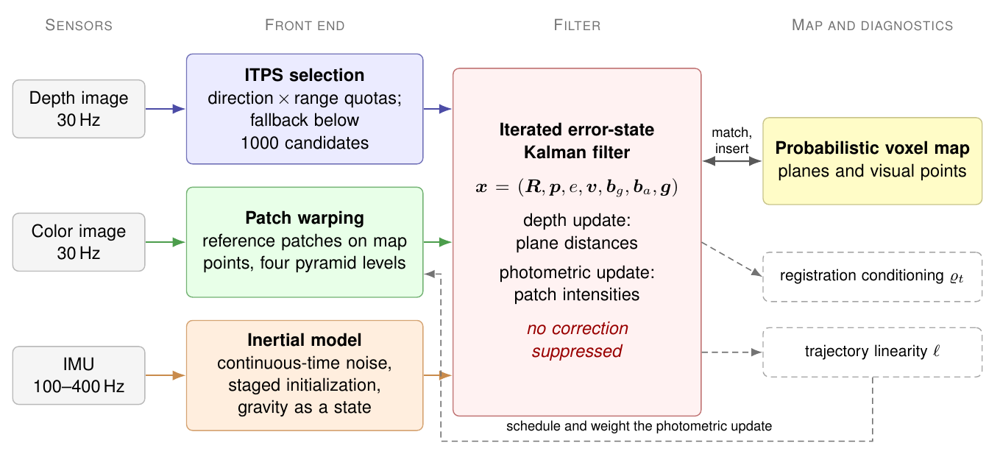
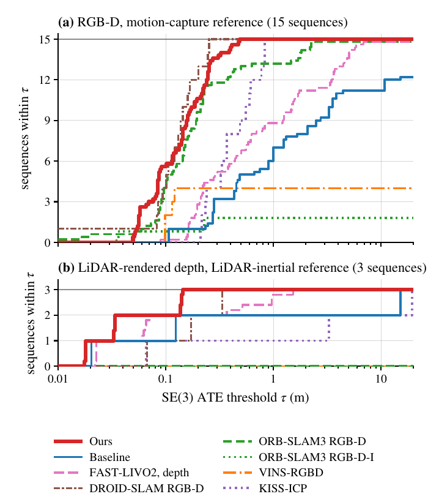

# Sampling, Fusion, and Covariance in RGB-D–Inertial Odometry under Depth Degeneracy

Code, configurations, and field recordings for the paper by Tuan-Anh Vu, Xiaoyang Zhao, and M. Khalid Jawed
(University of California, Los Angeles), which is under review.

[Project page](https://tuananh1007.github.io/RGBD-Inertial-Degeneracy/) ·
[Field recordings](https://huggingface.co/datasets/tuananh05253/RGBD-Inertial-Degeneracy-Field)

Consumer depth cameras often constrain motion weakly in large rooms, corridors, and outdoor scenes. The paper examines
how correction projection, point sampling, inertial weighting, and photometric fusion affect RGB-D–inertial odometry.
Its experimental platform, released here, is an iterated error-state Kalman filter on a shared probabilistic voxel map,
built on [FAST-LIVO2](https://github.com/hku-mars/FAST-LIVO2) and adapted to consumer depth cameras: depth points are
selected for geometric diversity (ITPS, with a depth-bin fallback for sparse depth), the IMU is modeled with
continuous-time noise densities, a staged initialization, and gravity as a state, and photometric updates on map
points are fused in the same filter. It runs on ROS Noetic, on the CPU.

<p align="center"></p>

## Contents

| Path | |
|---|---|
| `rgbd_vio/` | the estimator, a ROS 1 catkin package that compiles the FAST-LIVO2 sources it shares |
| `patches/fastlivo2/` | two patches to FAST-LIVO2 `0d2c034`: a photometric consistency gate and local photometric bundle adjustment, both off unless configured |
| `config/` | dataset, camera, and experiment configurations; [config/README.md](config/README.md) maps the methods of the paper to files |
| `scripts/` | dataset converters, the runner, and the evaluators |
| `Dockerfile` | the build: Ubuntu 20.04, ROS Noetic, pinned third-party commits; amd64 and arm64 |
| `docs/` | the project page |

## Results

On 18 primary sequences (15 consumer RGB-D recordings from UT-MM and OpenLORIS-Scene with motion-capture references,
and three FAST-LIVO2 sequences with sparse LiDAR-rendered depth and a correlated reference), the estimator completes
all 90 runs, replayed at the recorded rate, with translational absolute trajectory error below 0.5 m, which no other
online method compared in the paper achieves; the measured front-end stages average 12–22 ms per frame on four
desktop CPU cores. With matched triggers, storing the spliced covariance of a projected update raises the
per-sequence error by geometric-mean factors of 6 on UT-MM and 32 on OpenLORIS-Scene and diverges in every run of a
long outdoor sequence, whereas the same projection with the Joseph-form covariance has errors similar to the
unrestricted filter. The estimator fails on several additional scenes (long corridors, a crop row, the
OpenLORIS-Scene market, and the ROVER garden recordings), and its reported covariance is not calibrated; the paper and
its supplement report these cases.

<p align="center"></p>

## Build

```bash
git clone https://github.com/tuananh1007/RGBD-Inertial-Degeneracy.git && cd RGBD-Inertial-Degeneracy
docker build -t rgbd-inertial:v1.0 .          # about 5 min on an 8-core desktop; runs the two unit tests
pip install -r requirements.txt               # converters and evaluators, on the host
```

## Quick start: UT-MM `square-1`

```bash
# 1. Convert the UT-MM recording (writes square-1_d455.bag and the Vicon reference square-1_d455.gt.txt)
mkdir -p data/utmm
python3 scripts/convert_utmm.py /path/to/square-1.bag data/utmm/square-1_d455.bag

# 2. Play it in real time into the estimator (Ours = s_ours_lin), one run on cores 0-4
BASE_CFG=utmm.yaml CAM_CFG=camera_utmm.yaml \
  bash scripts/run_sequences.sh $PWD/results/utmm $PWD/data/utmm rgbd-inertial:v1.0 s_ours_lin 1 1 square-1

# 3. Score it: SE(3) ATE, 1 s RPE, completion -> results/utmm/metrics.csv
python3 scripts/evaluate_runs.py results/utmm data/utmm
```

`scripts/run_sequences.sh OUT DATA IMAGE "VARIANT ..." RUNS JOBS [SEQ ...]` plays every `<seq>_d455.bag` in `DATA`
(or the listed sequences) `RUNS` times for each experiment configuration `config/<VARIANT>.yaml`, in `JOBS` parallel
containers pinned to `CORES_PER_JOB` cores each (default 5), and writes `OUT/<VARIANT>_r<k>/<seq>_traj.txt` (TUM
format, IMU frame), the log, and a row per run in `OUT/runs.csv`. Existing trajectories are skipped. The paper ran
five runs per sequence with four cores per container on an otherwise idle machine; replay is real time, so results
vary from run to run.

## Datasets

All converters write `<seq>_d455.bag` with the topics the dataset configuration names, and the reference next to it.

| Dataset | Source | Conversion | Evaluation (`evaluate_runs.py OUT DATA ...`) |
|---|---|---|---|
| UT-MM (Sun et al., IROS 2024) | [Hugging Face](https://huggingface.co/datasets/neel1302/UT-MM) | `convert_utmm.py IN.bag OUT_d455.bag` | default |
| OpenLORIS-Scene (Shi et al., ICRA 2020) | [dataset page](https://lifelong-robotic-vision.github.io/dataset/scene) | `convert_openloris.py IN.bag --output OUT_d455.bag --gt SEQ_gt.txt`, then `openloris_gt_imu.py DATA SEQ ...` | `--gt-pattern '{seq}_gt_imu.txt'` |
| FAST-LIVO2 (Zheng et al., T-RO 2025) | [FAST-LIVO2](https://github.com/hku-mars/FAST-LIVO2); references from [VIGS-SLAM](https://vigs-slam.github.io) | `convert_fastlivo2_bag.py --input IN.bag --output OUT_d455.bag --seq retail` (or `hku` for `CBD_Building_02`) `--no-dense --max-depth 40`; the reference as `SEQ_d455.gt.txt` | default |
| Rosario v2 (Soncini et al., IJRR 2026) | [dataset page](https://cifasis.github.io/rosariov2/) | `convert_rosario.py IN.bag OUT_d455.bag --gt-in X_mins_tum.csv --gt-out SEQ_gt.txt` | `--gt-pattern '{seq}_gt.txt'` |
| ROVER (Schmidt et al., T-RO 2025) | [Hugging Face](https://huggingface.co/datasets/iis-esslingen/ROVER) | `convert_rover.py REC.zip calib_d435i.yaml OUT_d455.bag SEQ_gt.txt` (prints the prism lever arm) | `--gt-pattern '{seq}_gt.txt' --lever X Y Z` |
| TUM RGB-D (Sturm et al., IROS 2012) | [dataset page](https://cvg.cit.tum.de/data/datasets/rgbd-dataset) | `make_tum_bags.sh RAW_DIR OUT_DIR` (downloads; the IMU is synthesized from the reference) | default |
| ICL-NUIM (Handa et al., ICRA 2014) | [dataset page](https://www.doc.ic.ac.uk/~ahanda/VaFRIC/iclnuim.html) | `convert_icl_nuim.py SEQ_DIR --gt livingRoom0.gt.freiburg --output lr0fix_d455.bag`, then `regenerate_bag_imu.py lr0fix_d455.bag lr0s1_d455.bag --seed 100` (seeds 100–500 for the five noise realizations) | default; covariance consistency: `nees_sim.py OUT DATA` |
| Field recordings (this paper) | [Hugging Face](https://huggingface.co/datasets/tuananh05253/RGBD-Inertial-Degeneracy-Field) | none | no reference: `evaluate_field_runs.py OUT DATA --loops empty_1` (Site A) or `--loops Bolter_2` (Site B) |

The dataset and camera configuration of each dataset are listed in [config/README.md](config/README.md); for example,
OpenLORIS-Scene office runs use `BASE_CFG=openloris_tf.yaml CAM_CFG=camera_openloris.yaml`.

## Field recordings

Twelve recordings from the LiDAR-free platform that motivates the paper (a RealSense D455 and its BMI055 IMU logged on
an NVIDIA Jetson Orin NX): Site A, a commercial berry farm (greenhouse crop rows, raspberry canes, an open field in
sunlight), and Site B, corridors inside a university building. They have vibration-contaminated IMU data and no
external reference; the dataset card on Hugging Face lists the sequences, topics, and calibration.

```bash
BASE_CFG=field_site_a.yaml CAM_CFG=camera_field_d455.yaml \
  bash scripts/run_sequences.sh $PWD/results/site_a $PWD/data/site_a rgbd-inertial:v1.0 s_ours_lin 1 1
python3 scripts/evaluate_field_runs.py results/site_a data/site_a --loops empty_1
```

## Citation

```bibtex
@unpublished{vu2026sampling,
  title   = {Sampling, Fusion, and Covariance in {RGB-D}--Inertial Odometry under Depth Degeneracy},
  author  = {Vu, Tuan-Anh and Zhao, Xiaoyang and Jawed, M. Khalid},
  note    = {Under review},
  year    = {2026}
}
```

## License and acknowledgments

The code is released under the GNU General Public License v2, as is FAST-LIVO2, whose sources it compiles; the field
recordings are released under CC BY 4.0. The estimator builds on [FAST-LIVO2](https://github.com/hku-mars/FAST-LIVO2),
[rpg_vikit](https://github.com/xuankuzcr/rpg_vikit), and [Sophus](https://github.com/strasdat/Sophus), and the
evaluation uses the public datasets listed above. This work was supported by the California Department of Pesticide
Regulation. The contents may not reflect the official views or policies of the State of California.
